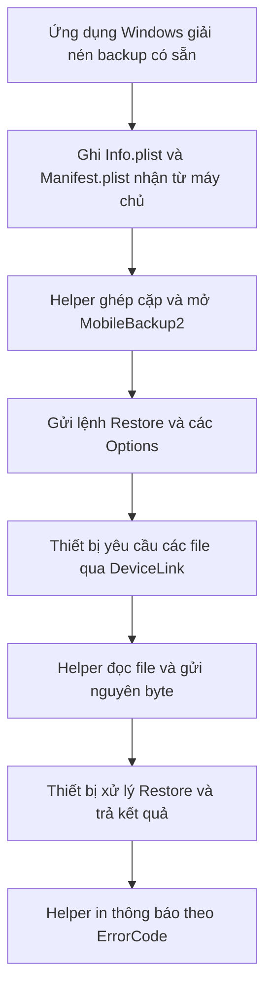

# Phương pháp quan sát được trong TM-BYPASS Windows

## Kết luận theo bằng chứng hiện có

Luồng MDM của mẫu sử dụng bản backup được đóng gói sẵn và dịch vụ Apple MobileBackup2 Restore. Phía Windows chuẩn bị backup cùng metadata, mở dịch vụ trên thiết bị, gửi yêu cầu Restore rồi phục vụ các yêu cầu trao đổi file từ thiết bị. Hàm gửi file được kiểm tra chuyển nguyên nội dung file, gồm cả ciphertext của backup nhúng.

Chưa xác định được các giá trị plaintext trong backup làm thay đổi trạng thái quản lý. Cũng chưa kiểm chứng thiết bị đã mất MDM hoặc cơ chế này áp dụng được cho iOS 27.0.1.



## Chế độ hoạt động thực tế

Tại `0x1400040de`, helper nạp giá trị `1`; tại `0x1400040f6`, nó gán giá trị đó cho thanh ghi mode `R12D`. Bảng switch ở `0x140005d6c` ánh xạ mode 1 tới `0x140004dea`, tức nhánh Restore. Đã thực thi đoạn khởi tạo và chín tình huống switch bằng Unicorn, không chạy dịch vụ thiết bị.

Các nhánh Backup, Info, List, Unback, ChangePassword và Cloud vẫn có trong mã. Sự tồn tại của chuỗi hoặc mã cho những nhánh này không cho biết chúng được chọn trong luồng MDM bình thường. Cách tổ chức, chuỗi chẩn đoán và giao thức truyền file tương đồng với `idevicebackup2`; mã nguồn 1.3.0 được dùng làm tham chiếu, chưa khẳng định đây là phiên bản nguồn chính xác của toàn bộ binary.

Ứng dụng C# gọi `RunMdmSetupProcess` với Arguments rỗng và chờ helper kết thúc. Backup nằm dưới `%TEMP%\ikey\<UDID>`. Helper lấy thiết bị USB theo API lookup của nó, đọc UDID rồi xây dựng đường dẫn cục bộ.

## Các bước chuẩn bị và điều kiện được kiểm tra trên PC

- `RunMdmBackupRestore` giải nén tools và backup, gọi `WriteMdmInfoPlist`, `WriteMdmManifestPlist`, sau đó chạy helper. Nội dung hai plist được nhận từ máy chủ; mã backend không nằm trong ZIP.
- Helper kiểm tra tồn tại `Info.plist` và đọc được `Manifest.plist`. Ở đoạn kiểm tra manifest trong main, trường được lấy ra là `IsEncrypted`.
- Helper dùng ghép cặp/handshake và mở các dịch vụ để thực hiện Restore; việc thiết bị cho phép ghép cặp và mở dịch vụ chưa được thử trên máy thật ở đây.
- Hàm `CheckFinishedSnapshotRecovered` tại `0x140002b10` chấp nhận khi `SnapshotState` là string đúng bằng `finished`.

Đã thử tám tình huống cho hàm kiểm tra Status. Một plist tối giản chỉ có `SnapshotState="finished"` được hàm này chấp nhận. Các trường Version, IsFullBackup và BackupState không được hàm kiểm tra này xác thực. Thiếu file, thiếu key, sai kiểu, sai chữ hoa/thường hoặc trạng thái khác đều trả false.

`Status.plist` nhúng thực tế khai báo `IsFullBackup=false`, `BackupState="new"`, `SnapshotState="finished"`. Đây là metadata của gói backup và điều kiện ở phía helper, không phải chứng nhận thiết bị sẽ chấp nhận toàn bộ backup.

## Yêu cầu Restore

Các Options của nhánh đang dùng đã được đối chiếu giữa mã máy, mã giả C và gói tin từ DLL:

```json
{
  "RestoreSystemFiles": false,
  "RestoreDontCopyBackup": true,
  "RestorePreserveSettings": true,
  "Password": "mdm"
}
```

Lệnh được đóng vào `DLMessageProcessMessage` với `MessageName="Restore"`, TargetIdentifier, SourceIdentifier và Options. Các phép thử không chứng minh tất cả domain trong backup sẽ được ghi lên thiết bị: việc đó còn do nội dung manifest, dữ liệu backup và chính sách Restore trên phiên bản iOS quyết định.

## Truyền file: bằng chứng mới từ mã máy

Đã thực thi trực tiếp hàm `0x140002dc0` trong ảnh bộ nhớ unpack, giữ nguyên mã máy và các import stub. Các API ngoài được thay bằng mô hình filesystem và MobileBackup2; các helper nối đường dẫn, định dạng kích thước và in log cũng được mô phỏng. Không có USB hoặc kết nối mạng. Kiểm tra stack và security cookie vẫn chạy trong mã máy với stack/TEB giả lập.

Tập kiểm tra gồm bảy kích thước tổng hợp tại biên 32 KiB, ciphertext `Manifest.db`, sáu blob khớp tên đường dẫn cấu hình, và ba tình huống lỗi.

- **14/14 ca thành công:** SHA-256 của phần dữ liệu thu lại đúng bằng đầu vào; không có byte payload bị đổi.
- **3/3 ca kiểm soát lỗi:** file thiếu, đọc lỗi và ghi thiếu đều làm helper trả `-1`; lỗi file cục bộ có metadata `DLFileErrorCode`/`DLFileErrorString`.
- Dữ liệu được đọc bằng `fopen(...,"rb")` và `fread`, chia thành khối tối đa `32768` byte.

Định dạng trên lớp raw:

| Thành phần | Nội dung |
| --- | --- |
| Tên file | uint32 big-endian độ dài, sau đó các byte tên file |
| Khối dữ liệu | uint32 big-endian `(số byte dữ liệu + 1)`, mã `0x0c`, rồi dữ liệu |
| Kết thúc thành công | uint32 big-endian `1`, mã `0x00` |
| Lỗi file cục bộ | mã `0x06` cùng mô tả lỗi trong khung tương ứng |

Nhánh `DLMessageDownloadFiles` trong main lấy danh sách đường dẫn do thiết bị gửi, rồi gọi hàm này cho từng file. Vì vậy hàm gửi được kiểm tra là một phần của luồng Restore đang dùng, không chỉ là mã thư viện không được gọi.

Các tên thao tác trong DeviceLink cần được đọc theo chiều trao đổi của phiên Restore:

| Thông điệp từ thiết bị | Công việc của helper phía Windows |
| --- | --- |
| `DLMessageDownloadFiles` | Đọc các đường dẫn được yêu cầu trong thư mục backup và gửi dữ liệu |
| `DLMessageUploadFiles` | Nhận dữ liệu vào filesystem của backup phía PC |
| `DLMessageCreateDirectory`, Move/Remove Files hoặc Items | Bảo trì đường dẫn trong thư mục backup phía PC theo yêu cầu giao thức |
| `DLMessageProcessMessage` chứa `ErrorCode` | Đọc kết quả của thao tác Restore |

Các nhánh thao tác file ở đây xây dựng đường dẫn dưới thư mục backup cục bộ. Khi đọc tên RemoveFiles trong helper, cần đối chiếu nơi thực hiện I/O; tên thông điệp tự nó không xác định một thao tác gỡ profile trên iPhone.

Các blob được thử gồm những file có SHA-1 tên trùng quy tắc `SHA1(domain + "-" + relativePath)` cho CloudConfigurationDetails, ClientTruth, ProfileTruth, purplebuddy và hai file UserConfigurationProfiles. Sự khớp tên nhận diện đường dẫn; **chưa cho biết giá trị bên trong các plist mã hóa**.

## Diễn giải phương pháp và giới hạn

Ở phía PC, đặc điểm chính là chuẩn bị backup rồi yêu cầu Restore. Trong hàm gửi file đã thực thi, ciphertext được chuyển nguyên vẹn; không có bước giải mã hay chỉnh giá trị MDM trong nội dung file tại ranh giới này. Tool có thể giao ciphertext, metadata và mật khẩu cho dịch vụ Restore; người phân tích vẫn cần keybag và ManifestKey tương ứng để đọc plaintext phục vụ nghiên cứu.

Template `resource_mdm` có các cờ quản lý nằm trong một nhánh SSH khác, chưa thấy tham chiếu gọi từ luồng nút MDM đang phân tích. Không lấy các cờ của template đó làm nội dung đã biết của backup mã hóa.

Helper in “IKEY MDM Successful” khi kết quả Restore có `ErrorCode=0`; chưa thấy bước đọc lại danh sách profile hoặc trạng thái enrollment sau Restore trong luồng này. Caller C# cũng không kiểm tra ExitCode. Cần tách kết quả truyền/Restore khỏi kết luận thiết bị hết MDM.

## Tệp bằng chứng

- `file-sender-evidence.json`: 14 ca dữ liệu và ba ca lỗi, hash và sự kiện API.
- `mode-dispatch-evidence.json`: khởi tạo mode, bảng nhánh và chín ca dispatch.
- `status-gate-evidence.json`: tám ca kiểm tra Status.plist.
- `manifest-db.device-link-stream.bin`: luồng raw thu từ ca truyền Manifest.db, vẫn chứa ciphertext.
- Script tái lập: `../probe_file_sender.py` và `../probe_mode_dispatch.py`.
